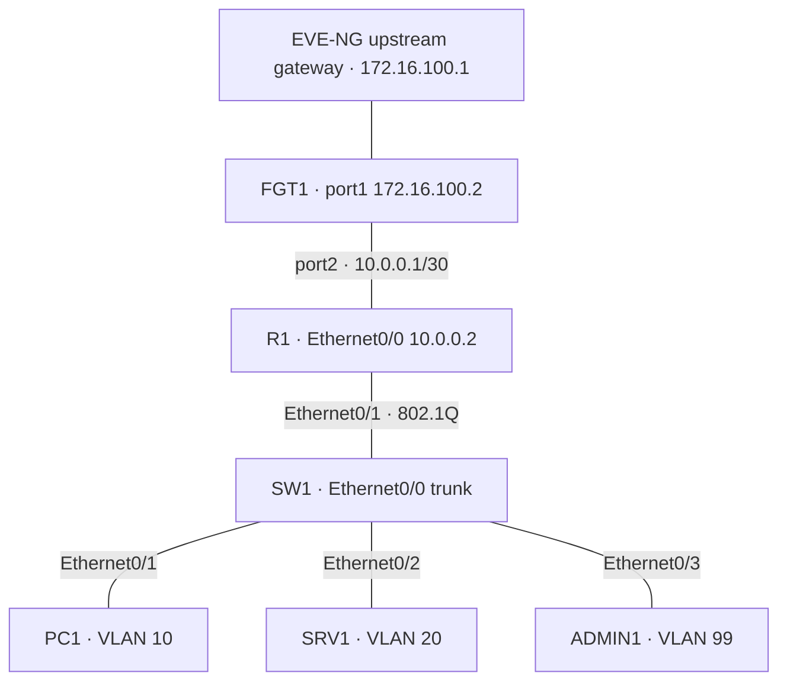
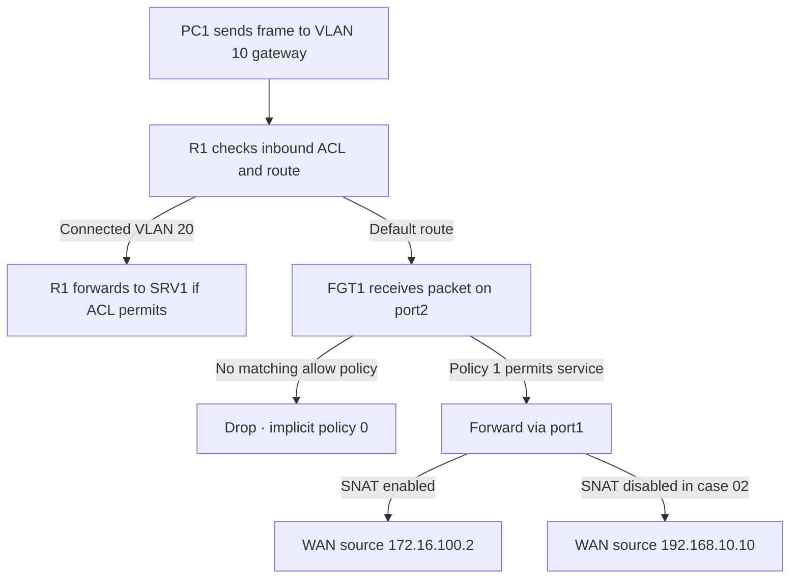

# Cisco + FortiGate fault investigation

On 17 November 2026 I used Cisco IOS XE IOL 17.12.1, FortiOS 7.6.2, Linux and Wireshark in EVE-NG to investigate ten controlled network scenarios. Each [case record](cases.md) gives the symptom, the observation that narrowed the cause and the result of the retest. The excerpts below were transcribed during the lab. Raw captures and full device configurations are pending.

## Topology



PC1, SRV1 and ADMIN1 use 192.168.10.10, 192.168.20.10 and 192.168.99.10 respectively. Each /24 has its gateway at .1 on R1. R1 defaults to FGT1. FGT1 routes 192.168.0.0/16 back to R1 and defaults to the upstream gateway via port1.

## Packet flow

From PC1 the destination determines which device can account for a failure. The internal server path ends on R1’s other VLAN. Internet traffic also crosses FGT1 policy 1 and the upstream NAT.



For the successful HTTPS session, FortiGate recorded a source translation on the outbound packet and the reverse mapping on the reply. In case 02, the WAN capture showed the private PC1 address leaving port1. The capture did not pinpoint where the reply path failed.

## Case guide

| Question | Cases |
| --- | --- |
| Did the firewall deny the packet or forward it untranslated? | [01 · Policy disabled](cases.md#01--internet-ping-stops-at-the-firewall), [02 · Missing SNAT](cases.md#02--policy-allows-traffic-but-ping-fails) |
| Where did a required route or VLAN disappear? | [03 · Default route](cases.md#03--r1-has-no-default-route), [04 · Access VLAN](cases.md#04--pc1-cannot-resolve-its-gateway), [05 · Allowed VLAN list](cases.md#05--gateway-responds-but-server-is-unreachable) |
| Why did an internal outage produce TTL-exceeded responses? | [06 · Connected route lost](cases.md#06--loss-of-a-connected-route), [07 · Summary discard](cases.md#07--contain-the-routing-loop) |
| Which protocol, rule or session explains the result? | [08 · ACL counters](cases.md#08--ssh-port-available-while-icmp-is-denied), [09 · DNS and sessions](cases.md#09--dns-and-stateful-return-traffic), [10 · Service restriction](cases.md#10--ping-works-while-dns-and-https-fail) |

## Session excerpts

```text
SW1# show interfaces trunk
Port    Status    Native vlan
Et0/0   trunking  1
Vlans allowed on trunk: 10,99        # injected fault, VLAN 20 missing

R1# show ip access-lists USERS_TO_SERVERS
10 permit tcp host 192.168.10.10 host 192.168.20.10 eq 22 (5 matches)
20 deny icmp host 192.168.10.10 host 192.168.20.10 log (4 matches)
30 permit ip any any (4 matches)

FGT1 (Debug Flow for DNS):
received a packet(proto=6, 192.168.10.10:47890->8.8.8.8:53) from port2, flag [S]
find a route ... gw-172.16.100.1 via port1
Denied by forward policy check (policy 0)

FGT1 (HTTPS session):
proto=6 ... policy_id=1
hook=post dir=org act=snat 192.168.10.10:49152->172.66.147.243:443(172.16.100.2:49152)
hook=pre dir=reply act=dnat 172.66.147.243:443->172.16.100.2:49152(192.168.10.10:49152)
statistic ... org=1429/12/1 reply=6005/12/1
```

The final lab state includes the inbound VLAN 10 ACL, the R1 /16 discard route and FortiGate policy 1 with service ALL and SNAT enabled. PC1-to-SRV1 ping is therefore expected to fail after case 08. The resolver change in case 09 lasts only for the running configuration. The [rollback runbook](runbook.md) lists the state to check before repeating a test.

[Project index](../README.md)
