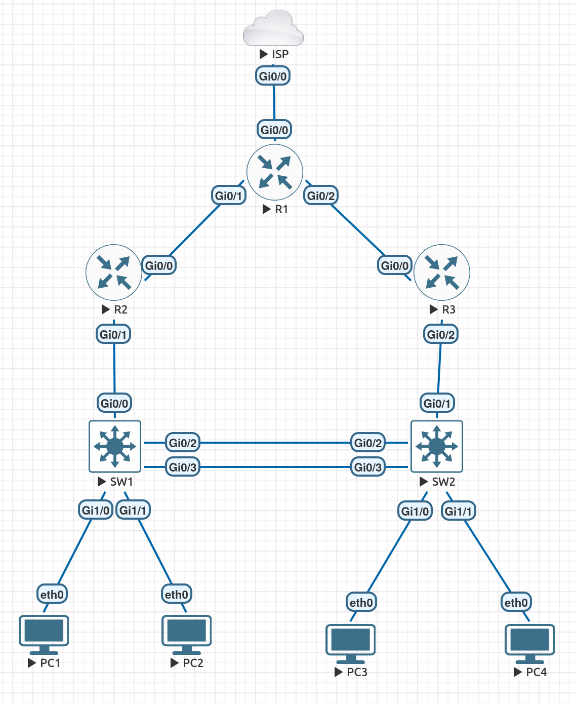

# Cisco enterprise network

I built a dual-stack campus in EVE-NG with two access switches, two first-hop routers and a simulated ISP. The verification captures show how forwarding responsibilities are split between devices.

## Network topology

R1 connects to the ISP on Gi0/0, R2 on Gi0/1 and R3 on Gi0/2. The ISP loopback represents the external destination 8.8.8.8. SW1 and SW2 carry the campus VLANs across an LACP trunk. R2 and R3 route between VLANs using 802.1Q subinterfaces.

| Routed link | IPv4 endpoints in diagram order | IPv6 design |
| --- | --- | --- |
| ISP Gi0/0 — R1 Gi0/0 | 203.0.113.1/30, 203.0.113.2/30 | IPv4 edge |
| R1 Gi0/1 — R2 Gi0/0 | 10.0.12.1/30, 10.0.12.2/30 | 2001:db8:12::1/64, 2001:db8:12::2/64 |
| R1 Gi0/2 — R3 Gi0/0 | 10.0.13.1/30, 10.0.13.2/30 | 2001:db8:13::1/64, 2001:db8:13::2/64 |

The campus design puts the STP root on the switch attached to the preferred HSRP router. Each IPv4 subnet uses .1 for the virtual gateway, .2 for R2 and .3 for R3.

| VLAN | Endpoints | IPv4 subnet | IPv6 prefix | STP root | HSRP active |
| --- | --- | --- | --- | --- | --- |
| 10 Users | PC1, PC3 | 192.168.10.0/24 | 2001:db8:10::/64 | SW1 | R2 |
| 20 Admin | PC2 | 192.168.20.0/24 | 2001:db8:20::/64 | SW1 | R2 |
| 30 Servers | PC4 | 192.168.30.0/24 | 2001:db8:30::/64 | SW2 | R3 |
| 99 Management | Infrastructure | 192.168.99.0/24 | 2001:db8:99::/64 | SW2 | R3 |

The design uses OSPF area 0 on the routed links, passive interfaces on user VLANs and a default route from R1 toward the ISP. The original device captures below show the operational state available for review.

## Verification and evidence

| Check | What the device reported | Original output |
| --- | --- | --- |
| OSPFv2 and ECMP | R1 had FULL adjacencies with 2.2.2.2 and 3.3.3.3. All four IPv4 VLAN routes had cost 2 through both 10.0.12.2 and 10.0.13.2. | [R1 neighbors and routes](../../verification/ospf.txt) |
| EIGRP for IPv4 (AS 100), separate IOL exercise | R1 learned 192.168.10.0/24 via R2 (10.0.12.2, Et0/1) and R3 (10.0.13.2, Et0/2). The topology table listed two successors. The routing table installed both next hops with metric 307200 and traffic share count 1 each. | [R1 neighbors, topology entry and routing table](../../verification/eigrp-vlan10.txt) |
| EIGRP transit and failover, separate IOL exercise | R2 and R3 formed an EIGRP AS 100 adjacency across dedicated VLAN 999 on the inter-switch trunk. R2 installed equal-cost paths to R1’s 10.0.13.0/30 subnet, through R1 on Ethernet0/0 and R3 at 10.0.23.2 on Ethernet0/1.999. With R1 Ethernet0/1 down, R1 retained the VLAN 10 route through R3, and a sourced ping to PC1 (192.168.10.21) succeeded. | [R2 backup route and R1 failover route](../../verification/eigrp-transit-failover.txt) |
| OSPFv3 | Two FULL adjacencies. R1 listed two next hops for VLANs 10, 20 and 30. The captured VLAN 99 entry shows one. | [IPv6 routes and interfaces](../../verification/ipv6.txt) |
| HSRP | Both routers agreed on active and standby roles in all four groups. The preferred active router had priority 110 and preemption enabled. | [R2 and R3 standby summaries](../../verification/hsrp.txt) |
| Rapid-PVST+ | SW1 was root for VLANs 10/20 and SW2 for 30/99. Detailed VLAN 10 and 30 outputs show RSTP. | [Per-VLAN root and port roles](../../verification/spanning-tree.txt) |
| LACP and trunks | Each switch reported Po1(SU) with Gi0/2 and Gi0/3 bundled. All four VLANs were allowed and forwarding on Po1. | [EtherChannel and trunk state](../../verification/etherchannel.txt) |
| DHCP | R2 held leases for VLANs 10 and 20. R3 held a lease for VLAN 30. | [Bindings and pools](../../verification/dhcp.txt) |
| Access security | On R2, USERS-IN counted five denies from Users to Management. SW1 recorded a sticky MAC on Gi1/0 and operational DHCP snooping for VLANs 10/20/30. | [ACL and switch security output](../../verification/security.txt) |
| NAT/PAT | R1 translated ICMP from 192.168.10.21 to 203.0.113.2. Its statistics also listed the R3-facing Gi0/2 as outside. | [NAT translations and interface roles](../../verification/nat.txt) |

### Access-layer design

The design applies USERS-IN inbound on the VLAN 10 subinterfaces of R2 and R3. The archive includes counters from R2. SW1’s access ports Gi1/0 and Gi1/1 use restrict mode with a one-address limit. DHCP snooping output lists those ports as untrusted with a 15-packet-per-second limit, and Po1 and the uplinks as trusted. Full running configurations for both routers and switches are pending.

## EIGRP transit and failover exercise

This was a separate IOL exercise from the OSPF campus evidence above. VLAN 999 was added to the router-facing trunks and the inter-switch Port-channel. R2 Ethernet0/1.999 uses 10.0.23.1/30; R3 Ethernet0/2.999 uses 10.0.23.2/30. Both subinterfaces participate in EIGRP AS 100 and are non-passive. R2 and R3 formed an adjacency.

With R1 Ethernet0/1 shut down, R1 kept its EIGRP route to 192.168.10.0/24 through R3. R2 used its EIGRP route through R3 to return traffic destined to R1 10.0.13.1. The operator reported a successful five-echo ping to PC1 during this test. The CLI transcript preserves the route output. The raw ping result was not retained.

## Follow-up tests

- **HSRP failover.** Record both routers’ roles and continuous pings from VLAN 10 to the gateway and a remote destination. In the lab, take R2 Gi0/1 down, record R3’s state and packet loss, then restore the interface and record preemption and connectivity.
- **NAT.** Reconcile the diagram with the R1 interface configuration, then test egress through R2 and R3 individually. [Open NAT audit](../../troubleshooting/nat-interface-audit.md)
- **IPv6.** Test reachability between hosts on different VLANs and record the source, destination and replies. The archive currently covers router adjacencies and learned routes.
- **Configuration.** Archive sanitized device exports and a DHCP snooping binding table. [Configuration export notes](../../configs/README.md)

[Portfolio](../../README.md) · [Project index](../README.md)
